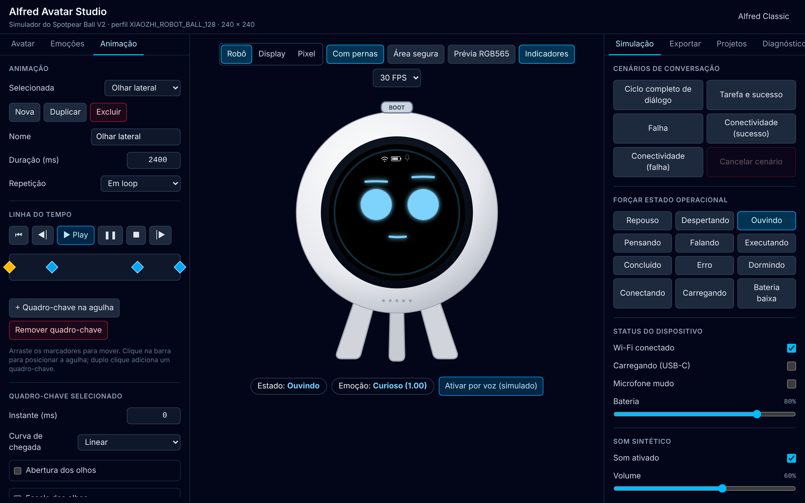

# Alfred Avatar Studio



Aplicação local para criação, personalização, animação, simulação e preparação de avatares para o assistente físico **Alfred**, baseado no dispositivo comercial **Spotpear Ball V2** (comercializado como XiaoZhi AI Voice Chat Robot Ball / DeepSeek Chat Robot).

---

## 📖 Especificação Completa

Toda a especificação técnica detalhada, arquitetura de software, mapeamento de pinos do hardware, requisitos funcionais e critérios de aceite estão documentados no:

👉 [**PRD.md**](./PRD.md) (Versão 1.4)

O planejamento dos testes de ponta a ponta (Playwright) está em:

👉 [**docs/PLANO_E2E.md**](./docs/PLANO_E2E.md)

---

## ▶️ Como executar

Requisitos: Node.js 20 ou superior (nativo ARM no macOS: `brew install node`).

```bash
npm install
npm run dev        # http://127.0.0.1:5173 (somente loopback)
```

Funciona 100% offline após a instalação das dependências. Os projetos ficam salvos no IndexedDB do navegador; use **Projetos → Exportar JSON** para backup.

### Testes

```bash
npm test                                  # Vitest (lógica)
npx playwright install chromium webkit    # uma vez
npm run test:e2e                          # Playwright (E2E)
npm run test:e2e:smoke                    # suíte rápida
npm run test:e2e:update                   # regenera imagens de referência visuais
```

### Atalhos

| Ação | Como |
|---|---|
| Botão físico Boot (GPIO 0), Push-to-Talk | Clique no botão **BOOT** do robô ou segure **B** / **barra de espaço** |
| Toque simples, prolongado (500 ms) e swipe | Mouse ou toque sobre a tela circular |

---

## 🧱 Estrutura

```text
src/
├── domain/      # tipos, perfil, máquina de estados, emoções, AvatarEngine, schema do projeto
├── render/      # CanvasRenderer (240 × 240) e conversões RGB565
├── input/       # coordenadas lógicas e reconhecedor de gestos (CST816 simulado)
├── audio/       # AudioFeedback (Web Audio API)
├── runtime/     # Simulator (laço de renderização fora do React) e store do projeto
├── storage/     # persistência IndexedDB (idb)
├── export/      # PNG, pacote ESPHome, spritesheet, MJPEG, C Array/LVGL
└── ui/          # interface React + Tailwind
e2e/             # testes Playwright por fase (ver docs/PLANO_E2E.md)
```

---

## 🎯 Visão Geral do Hardware Alvo

* **Dispositivo:** Spotpear Ball V2 (`sp-esp32-s3-1.28-box`)
* **SoC:** Espressif ESP32-S3 (Dual-Core 240 MHz, 16 MB Flash, 8 MB PSRAM)
* **Display:** 1.28" LCD IPS Circular (240 × 240 px, GC9A01 SPI)
* **Touchscreen:** CST816D (I²C)
* **Áudio:** Codec Everest ES8311 (I²S + I²C), microfone MEMS e alto-falante ampliado
* **Armazenamento:** Slot MicroSD (TF Card) com suporte nativo a vídeo MJPEG e áudio MP3
* **Entradas Físicas:** Botão Boot / Action (`GPIO 0`) e sensor de toque
* **Alimentação:** USB Type-C com circuito de carga para bateria LiPo
* **Firmwares Compatíveis:** XiaoZhi AI nativo (DeepSeek) e ESPHome / Home Assistant

---

## 🚀 Fases do Projeto

1. **Fase 1 — Simulador Básico** ✅ Modos Robô/Display/Pixel, Canvas 2D, estados operacionais, botão físico e persistência no IndexedDB.
2. **Fase 2 — Personalização e Emoções** ✅ 10 emoções com intensidade, comportamentos espontâneos, quantização RGB565 e exportação PNG/ESPHome.
3. **Fase 3 — Animação e Som** ✅ Linha do tempo de keyframes, gestos de swipe, feedback sonoro sintético via Web Audio API, exportação Spritesheet, MJPEG para cartão SD e C Array LVGL.
4. **Fase 4 — Validação Física:** Inspeção em bancada, teste direto via cartão MicroSD e backup de firmware. *(aguardando o equipamento)*
5. **Fase 5 — Integração Completa:** Integração com XiaoZhi AI ou ESPHome como satélite de voz local. *(aguardando a Fase 4)*

As limitações de verificação no ambiente atual estão na seção 12 de [docs/PLANO_E2E.md](./docs/PLANO_E2E.md).
